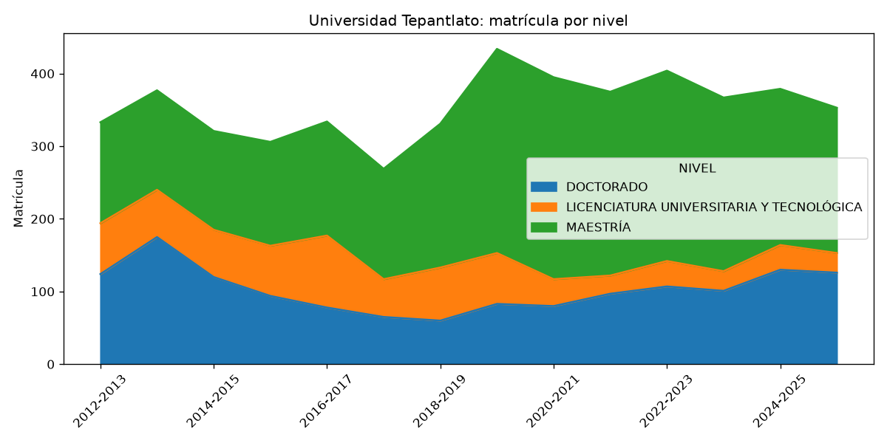
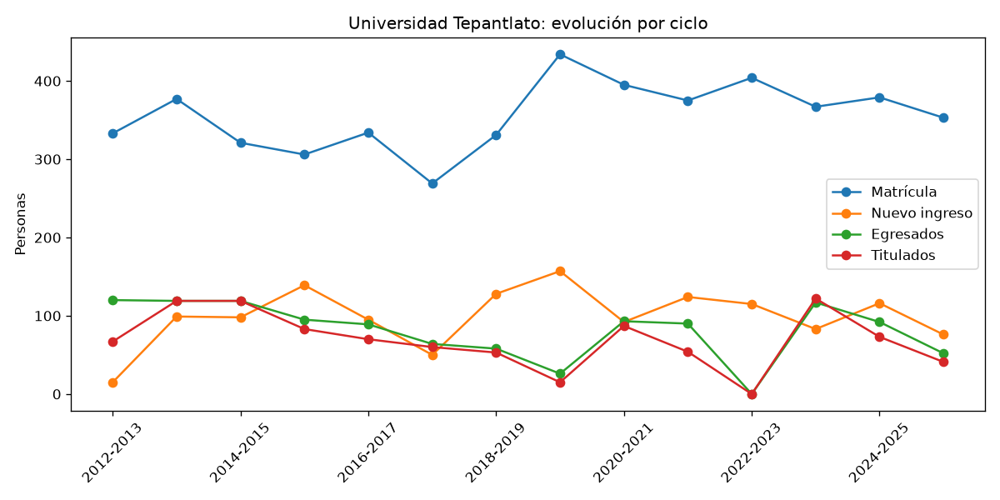
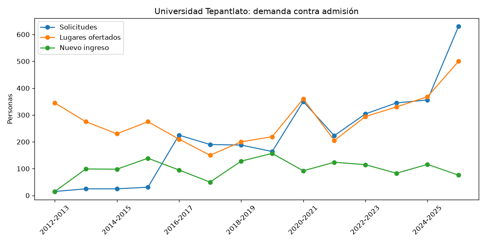
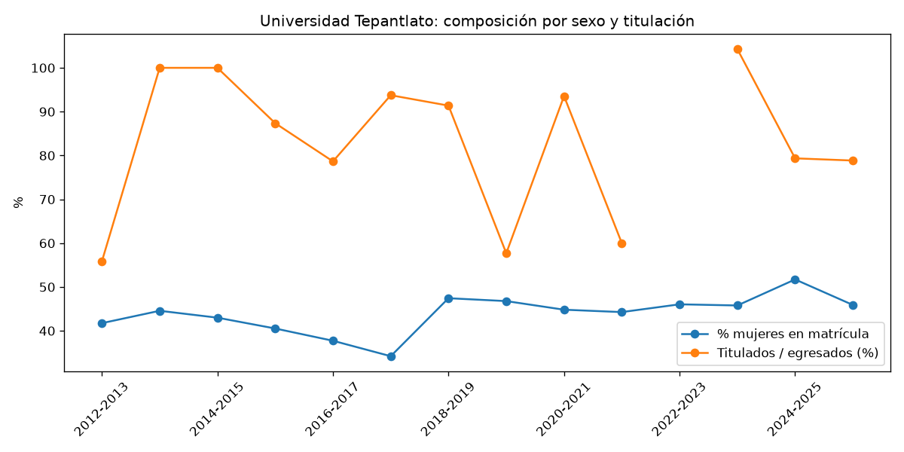

# Anuario ANUIES a CSV

Descarga completa del [Anuario Estadístico de Educación Superior de ANUIES](https://anuario.anuies.mx/index.php) a archivos CSV, y un caso de uso: la evolución de la **Universidad Tepantlato** (CDMX) entre 2012 y 2026.

- **26 ciclos escolares**, de 2000-2001 a 2025-2026
- **6 variables**: matrícula, nuevo ingreso, solicitudes de nuevo ingreso, lugares ofertados, egresados y titulados, todas desglosadas por sexo excepto lugares ofertados
- **Nivel programa por escuela**: unas 950 mil filas, 270 MB en total

## Uso

Requiere [uv](https://docs.astral.sh/uv/). No hace falta instalar Python ni dependencias a mano.

```bash
uv run extraer.py              # descarga los 26 ciclos a data/ (≈ 40 min)
uv run extraer.py 2024-2025    # o solo los ciclos que indiques
uv run tepantlato.py           # caso de uso → casos/tepantlato/
```

`extraer.py` solo usa la biblioteca estándar. Hace una petición a la vez con 1.5 s de pausa, reintenta hasta 3 veces si algo falla y, si lo vuelves a correr, se salta los ciclos que ya descargó. Cada ciclo se escribe primero como `.part` y solo pasa a `.csv` cuando terminó completo.

## Cómo funciona

El sitio del anuario no muestra los datos en el HTML: la página manda un `POST` a su propia URL y recibe JSON paginado. El script hace la misma petición que el navegador:

```
POST https://anuario.anuies.mx/index.php
action=consulta  ciclo=2024-2025  vars[]=MATRÍCULA  vars[]=EGRESADOS ...
desagSexo=1  includeInstitucion=1  includeEscuela=1  includePrograma=1 ...
page=1  pageSize=3000
```

La respuesta trae `dims` (columnas descriptivas), `cols` (columnas numéricas), `rows` y `meta.hasMore` para seguir paginando. Además existe `historico.php`, que acepta rangos de ciclos y tiene un buscador de instituciones (`action=instituciones&q=...`).

## Columnas de `data/anuies_<ciclo>.csv`

| Columna | Descripción |
|---|---|
| `CICLO` | Ciclo escolar, p. ej. `2024-2025` |
| `ENTIDAD`, `MUNICIPIO_CORREGIDO` | Ubicación de la escuela |
| `SOSTENIMIENTO`, `CLASIFICACION` | Público / particular y subsistema |
| `ANUIES` | 1 si la institución está asociada a ANUIES |
| `NOMBRE_INSTITUCION`, `NOMBRE_DE_ESCUELA_CAMPUS_FACULTAD` | Institución y plantel |
| `NIVEL`, `MODALIDAD`, `CAMPO_AMPLIO`, `CARRERA` | Programa |
| `M_M`, `M_H`, `MAT_TOTAL` | Matrícula: mujeres, hombres, total |
| `NI_M`, `NI_H`, `NI` | Nuevo ingreso |
| `SNI_M`, `SNI_H`, `SNI` | Solicitudes de nuevo ingreso |
| `LO_REAL` | Lugares ofertados (sin desglose por sexo) |
| `E_M`, `E_H`, `E` | Egresados |
| `T_M`, `T_H`, `T` | Titulados |

Los datos crudos (`data/`) no se versionan porque pesan 270 MB; se regeneran con `extraer.py`.

## Caso de uso: Universidad Tepantlato

Universidad particular con una sola sede, en Cuauhtémoc, CDMX (en dos registros aparece como "UNIVERSIDAD TEPANTLATO (ROMA)"). Aparece en el anuario a partir de **2012-2013**: no figura en ningún ciclo anterior. Los resultados están en [`casos/tepantlato/`](casos/tepantlato/):

| Archivo | Contenido |
|---|---|
| `tepantlato.csv` | Todas sus filas del anuario |
| `resumen_por_ciclo.csv` | Totales por ciclo, % de mujeres, tasa de titulación y número de programas |
| `matricula_por_nivel.csv` | Matrícula por ciclo y nivel |
| `programas.csv` | Primer y último ciclo con matrícula de cada programa |

### Una escuela de posgrado en Derecho



La matrícula total se mantiene estable, entre 270 y 430 estudiantes. La **maestría** es el núcleo y desde 2018-2019 concentra más de la mitad de la matrícula; el doctorado tiene entre 60 y 175 estudiantes. La licenciatura pasa de unos 100 estudiantes en 2016-2017 a menos de 40 desde 2020.

Su oferta original era toda de Derecho: la licenciatura y posgrados en ciencias penales, derecho civil, constitucional, familiar y amparo. Después se diversificó:

| Programa | Primer ciclo con matrícula |
|---|---|
| Lic. en Ingeniería en Tecnologías de la Información | 2015-2016 |
| Maestría en Educación | 2015-2016 |
| Maestría en Juicios Orales | 2016-2017 |
| Doctorado en Derecho Penal | 2019-2020 (sin matrícula en 2025-2026) |

### Evolución general



### Crecen las solicitudes y los lugares, pero no los inscritos



Las solicitudes de ingreso pasan de 15 (2012-2013) a 630 (2025-2026), y los lugares ofertados crecen casi al mismo ritmo. El nuevo ingreso, en cambio, se queda entre 80 y 150 por ciclo: la oferta y la demanda declaradas crecen, pero no la inscripción real.

### Más mujeres; titulación irregular



La proporción de mujeres en la matrícula pasa de un mínimo de 34% (2017-2018) a 46–52% en los últimos ciclos. La relación entre titulados y egresados varía mucho de un año a otro (ver advertencias).

### Advertencias sobre los datos

- **2022-2023 reporta 0 egresados y 0 titulados.** Casi seguro es una omisión en el reporte, no un año real sin egreso.
- **Titulados / egresados no es una tasa de cohorte.** En 2023-2024 supera el 100% porque se titulan personas que egresaron en años anteriores.
- **Solicitudes antes de 2016-2017.** Hay menos solicitudes que nuevos ingresos, lo que sugiere que las solicitudes se reportaban de forma incompleta.
- **Las cifras se usan tal como las publica el anuario**, sin corregirlas.

## Fuente

Datos: ANUIES, *Anuario Estadístico de Educación Superior*, consultado en noviembre de 2026. Los datos son de ANUIES; este repositorio solo automatiza su descarga.
